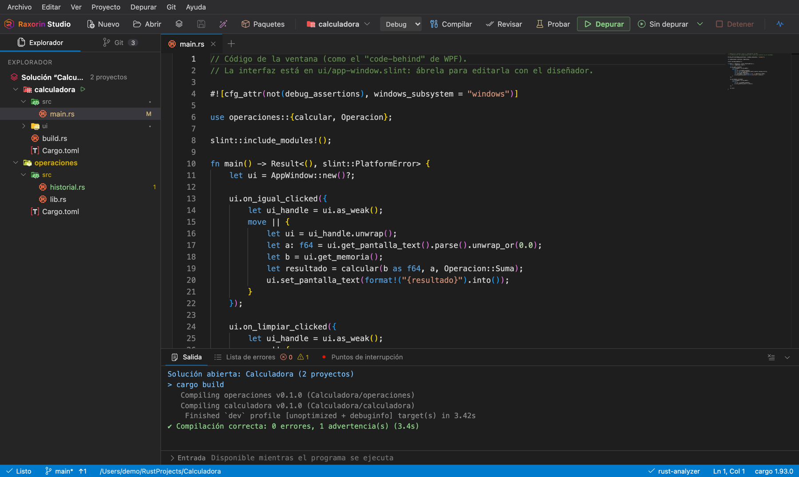
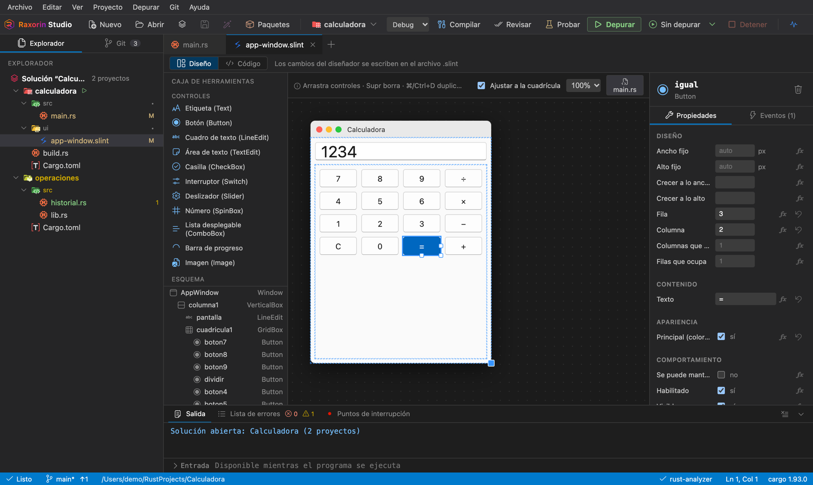
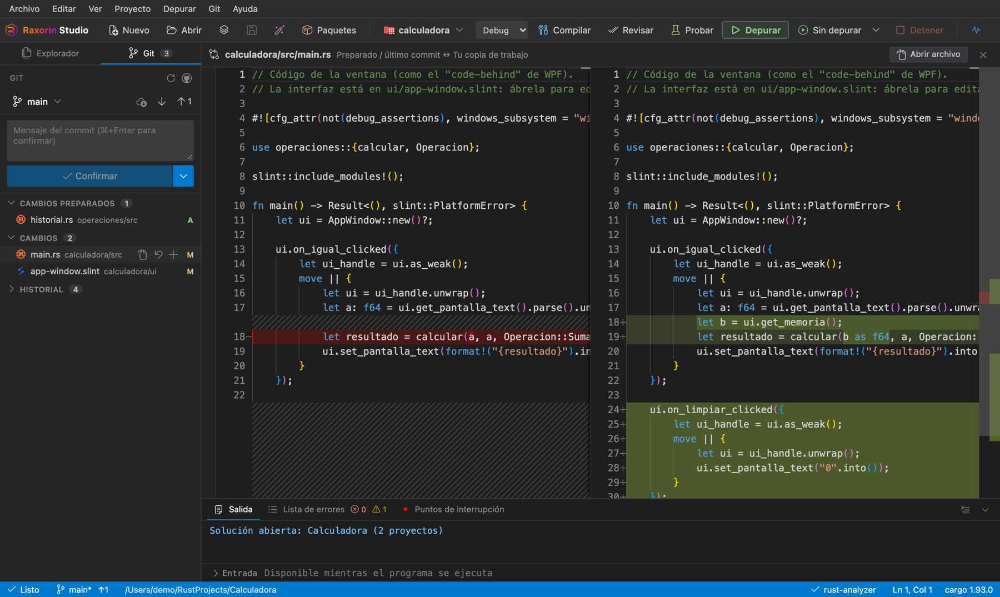
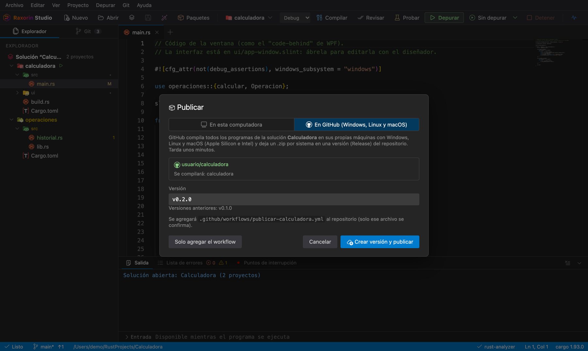
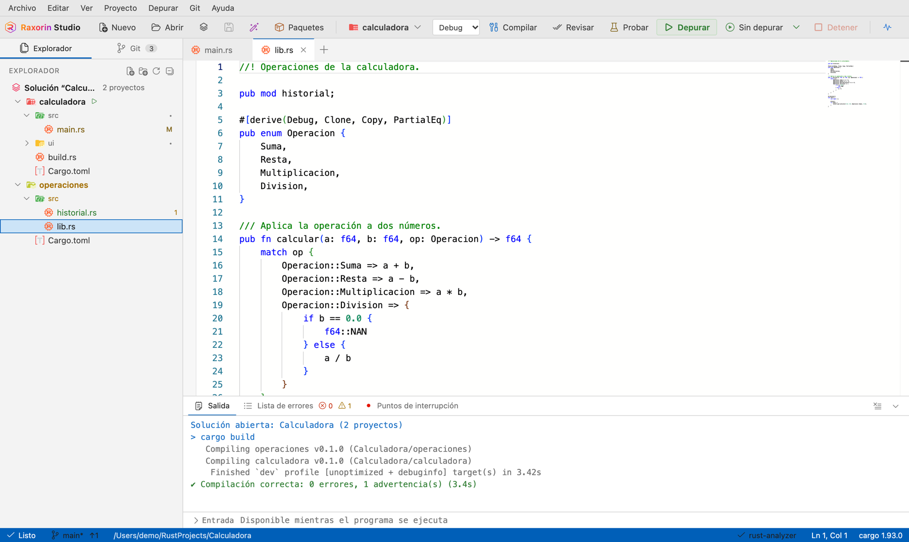

<p align="center">
  
</p>

<h1 align="center">Raxorin Studio</h1>

<p align="center">
  <strong>An IDE that makes building Rust programs easy, inspired by Visual Studio.</strong><br />
  Code editor with completions, visual window designer, debugger, Git, and publishing for Windows, Linux and macOS.
</p>

<p align="center">
  <a href="README.md">Español</a> · <strong>English</strong>
</p>

<p align="center">
  <a href="https://github.com/rampad/Raxorin-Studio/releases"></a>
  
  <a href="LICENSE"></a>
  
</p>

<p align="center">
  
</p>

> **Note:** the user interface is currently in **Spanish**. The screenshots below show it as it is.

## What is Raxorin Studio?

Raxorin Studio brings the **Visual Studio** experience to Rust: open or create a project, write code with
real-time help, design windows by dragging controls (like WPF), debug with breakpoints and publish a
ready-to-share program — without having to learn the `cargo` command line.

## Features

### Rust editor
- **Monaco** editor (the one in VS Code) powered by **rust-analyzer**: completions, go to definition,
  find references, rename, quick fixes and hover information.
- Built-in **Clippy** and **rustfmt**: *Revisar* (Check) suggests improvements and *Formatear* (Format)
  tidies up the code — optionally on every save.
- Visual Studio–style **Error List** — click to jump to the line.
- **Package manager** (crates.io): search, install, update and pick *features*, with recommendations.
- Drag to reorder tabs, a **＋** button for new files and optional auto-save.

### Visual window designer (Slint)

<p align="center">
  
</p>

- Drag controls onto the window: buttons, text boxes, check boxes, lists, sliders, images…
- **Automatic layouts**: column (`VerticalBox`), row (`HorizontalBox`), grid (`GridBox`), titled groups and
  **tabs** (`TabWidget`). A blue line shows where each control will land.
- **Properties** and **events** panels: connecting an event creates the function in `main.rs`, like
  WPF's *code-behind*.
- The designer reads and writes the `.slint` file, so you can switch between **Design** and **Code** at any time.
- **Import from Figma**: export a Figma screen with the [Raxorin Studio Export](https://github.com/rampad/Raxorin-Figma)
  plugin and it becomes editable controls (Auto Layout → columns and rows, `Button`, `Input`, `Checkbox`…
  components → real controls, design-system colors → `global Tema`).

### Debugger
- **F5** just like Visual Studio: breakpoints (including **conditional**, **hit count** and **log messages**
  that don't stop the program), stepping, call stack and editable variables.
- A **debug console** to evaluate expressions and **diagnostics** with CPU and memory charts of your program.
- Stops on *panics* and shows where they happened.

### Git and GitHub

<p align="center">
  
</p>

- **Git** panel: stage, discard, **side-by-side diffs**, commit (and *amend*), *stash*, history.
- **Branches**: create, switch, merge and delete. **Fetch, pull and push** with ↓↑ indicators.
- **Publish to GitHub** in one click (creates the repository in your account), clone repositories and open them in the browser.
- The explorer marks modified (M), new (U) and deleted (D) files; the status bar shows the current branch.

### Build and publish

<p align="center">
  
</p>

- **Debug / Release** configurations, like Visual Studio.
- **Publish on this computer**: builds in Release mode and puts the executable in a folder ready to share
  (plus a `.zip`). From macOS you can also publish for **Windows** (Raxorin Studio installs what's needed in one click).
- **Publish on GitHub**: adds a GitHub Actions workflow that builds your programs on **Windows, Linux and
  macOS** machines (Apple Silicon and Intel) and uploads them to a *Release*.

### Solutions (`.rxsln`)
- Like Visual Studio solutions: group several projects (apps and libraries) from any folder.
- **Startup project**, project references and a single Git repository for the whole solution.
- Double-clicking a `.rxsln` file opens Raxorin Studio.

### Make it yours

<p align="center">
  
</p>

- **Light and dark themes** (or follow the system).
- **Resizable panels** that can be hidden (⌘/Ctrl+B and ⌘/Ctrl+J).
- **Customizable toolbar**: choose which buttons to show and in which order.
- Editor **settings**: font size, tab size, word wrap, minimap…

## Install

Download the installer from [**Releases**](https://github.com/rampad/Raxorin-Studio/releases):

| System | File |
|---|---|
| macOS (Apple Silicon / Intel) | `.dmg` |
| Windows | `.msi` or `-setup.exe` |
| Linux | `.deb`, `.rpm` or `.AppImage` |

**Requirement:** Rust must be installed ([rustup.rs](https://rustup.rs)). Raxorin Studio offers to install
rust-analyzer, Clippy and rustfmt if they're missing. Git features use `git` and, optionally,
[GitHub CLI](https://cli.github.com) (`gh`).

**It updates itself:** on startup it checks for new versions and asks before installing them. Updates
are signed, so only official versions get installed (stable or beta channel, under
*Configuración → Actualizaciones*).

> **macOS:** the app isn't signed with an Apple certificate yet. The first time, open it with
> right-click → **Open** (or *System Settings → Privacy & Security → Open Anyway*).

## Getting started

1. **Nuevo** (New) → **Aplicación de consola** (console app) or **Aplicación de ventana** (window app, to use the designer).
2. Write your code and press **Ctrl/⌘+F5** to run it, or **F5** to debug it.
3. In a window app, open `ui/app-window.slint` to launch the **designer**. Drag controls and, under
   *Eventos* (Events), connect what happens on click.
4. When it's ready: **Proyecto → Publicar…** (Project → Publish…)

## Keyboard shortcuts

| Key | Action |
|---|---|
| F5 | Debug (or continue when paused) |
| Ctrl/⌘+F5 | Run without debugging |
| Shift+F5 | Stop |
| Ctrl/⌘+Shift+F5 | Restart debugging |
| F9 | Toggle breakpoint |
| F10 / F11 / Shift+F11 | Step over / step into / step out |
| Ctrl/⌘+Shift+B | Build |
| Ctrl/⌘+S · Ctrl/⌘+Shift+S · Ctrl/⌘+Alt+S | Save · Save as · Save all |
| Ctrl/⌘+N · Ctrl/⌘+Shift+N · Ctrl/⌘+O | New file · New project · Open file |
| Ctrl/⌘+B · Ctrl/⌘+J | Toggle explorer · bottom panel |
| Ctrl/⌘+Shift+E · Ctrl/⌘+Shift+G | Explorer · Git |
| Ctrl/⌘+, | Settings |
| F12 / Ctrl/⌘+click · Shift+F12 · F2 | Go to definition · Find references · Rename |
| Ctrl/⌘+. · Shift+Alt+F | Quick fixes · Format (rustfmt) |

## Development

**Stack:** Tauri 2 (Rust backend) · React + TypeScript · Monaco Editor · rust-analyzer (LSP) ·
lldb-dap (DAP) · Slint.

```bash
npm install
npm run tauri dev          # run in development
npm test                   # frontend tests (designer, layouts, toolbar, settings)
cd src-tauri && cargo test # backend tests
```

### Building installers

```bash
npm run tauri build        # installer for your OS (src-tauri/target/release/bundle/)
```

To build for every OS at once, GitHub Actions is used (`.github/workflows/instaladores.yml`): bump the
version in `package.json` and `src-tauri/tauri.conf.json`, then `git tag v0.3.0 && git push origin v0.3.0`.
A draft *Release* is created with the macOS, Windows and Linux installers.

### Project layout

```
src/                      Frontend (React + TypeScript)
  App.tsx                 Main state, menus, shortcuts and Monaco integration
  api.ts                  Backend calls
  components/             Toolbar, menus, explorer, editor, dialogs
  designer/               Slint designer: .slint reader/writer, layouts, canvas, properties
  debug/                  Debugger: DAP client, breakpoints, panels, diagnostics
  git/                    Git panel, diffs and GitHub dialogs
  lsp/                    rust-analyzer client and Monaco providers
  theme.ts, layout.ts     Light/dark theme and panel sizes
src-tauri/src/            Backend (Rust)
  runner.rs               Build, run, publish and cross-compile
  git.rs                  Git, GitHub (gh) and GitHub Actions workflows
  dap.rs, monitor.rs      Debugger (lldb-dap) and CPU/memory sampling
  lsp.rs, toolchain.rs    rust-analyzer and Rust tooling
  crates.rs               Package manager (crates.io)
  solution.rs, projects.rs  .rxsln solutions and Cargo projects
  fs_cmds.rs, watcher.rs  Files, project templates and file watching
```

## Roadmap

- [x] Console projects, editor, build and run, error list
- [x] rust-analyzer, Clippy, rustfmt and package manager
- [x] Visual designer with Slint, automatic layouts and tabs
- [x] Debugger with conditional breakpoints and CPU/memory diagnostics
- [x] `.rxsln` solutions
- [x] Themes, resizable panels, customizable toolbar and settings
- [x] Publishing (Release, Windows from macOS and GitHub Actions)
- [x] Built-in Git and GitHub
- [ ] Code signing for macOS and Windows
- [ ] Debugging on Windows
- [ ] Installers (`.dmg`, `.msi`) for the programs you build
- [ ] English user interface

## License

Raxorin Studio is released under the [MIT license](LICENSE).

The programs you build with Raxorin Studio are yours. If they use **Slint** for the UI, they're subject to
[Slint's license](https://slint.dev/terms-and-conditions) (free for desktop apps with attribution,
GPL-3.0 or commercial).

## Credits

- UI icons: Microsoft's [Codicons](https://github.com/microsoft/vscode-codicons) — CC BY 4.0.
- File and folder icons: [Material Icon Theme](https://github.com/material-extensions/vscode-material-icon-theme) — MIT
  (see `src/assets/file-icons/LICENSE-material-icon-theme`).
- Built with [Tauri](https://tauri.app), [Monaco Editor](https://github.com/microsoft/monaco-editor),
  [rust-analyzer](https://rust-analyzer.github.io), [Slint](https://slint.dev) and [React](https://react.dev).

<sub>Screenshots show a sample project (a calculator).</sub>
