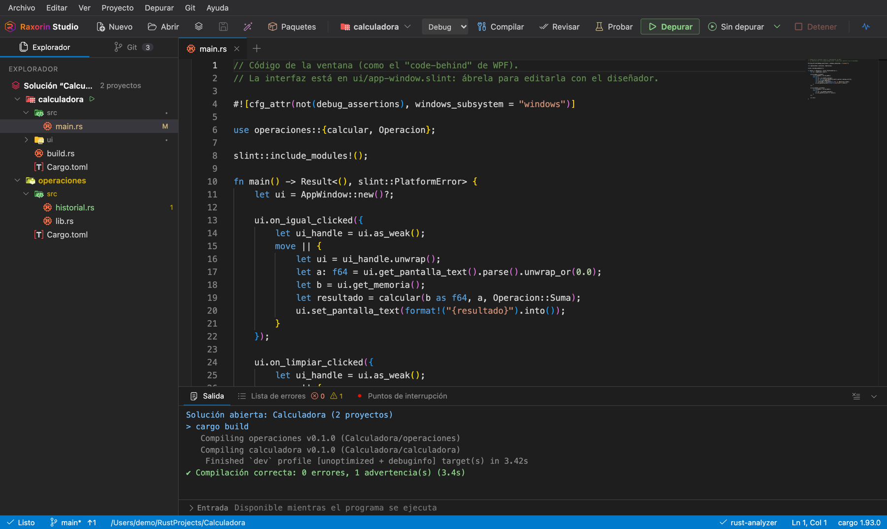
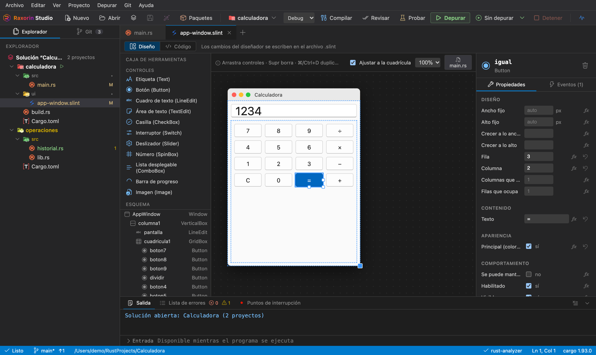
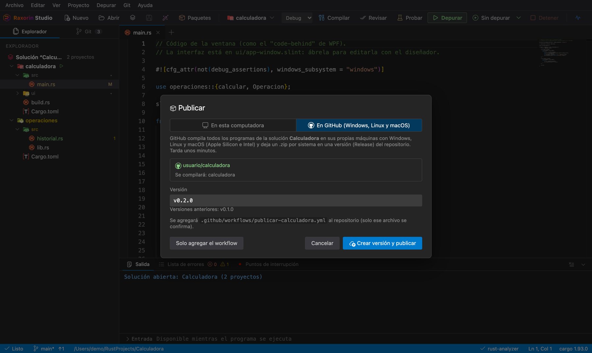

<p align="center">
  
</p>

<h1 align="center">Raxorin Studio</h1>

<p align="center">
  <strong>Un IDE para crear programas en Rust de forma fácil, inspirado en Visual Studio.</strong><br />
  Editor con autocompletado, diseñador visual de ventanas, depurador, Git y publicación para Windows, Linux y macOS.
</p>

<p align="center">
  <strong>Español</strong> · <a href="README.en.md">English</a>
</p>

<p align="center">
  <a href="https://github.com/rampad/Raxorin-Studio/releases"></a>
  
  <a href="LICENSE"></a>
  
</p>

<p align="center">
  
</p>

## ¿Qué es Raxorin Studio?

Raxorin Studio lleva la experiencia de **Visual Studio** a Rust: abres o creas un proyecto, escribes código
con ayuda en tiempo real, diseñas ventanas arrastrando controles (como en WPF), depuras con puntos de
interrupción y publicas el programa listo para compartir. En español o en inglés, y sin tener que aprender la
línea de comandos de `cargo`.

## Características

### Editor de Rust
- Editor **Monaco** (el de VS Code) con **rust-analyzer**: autocompletado, ir a definición, buscar
  referencias, renombrar, acciones rápidas e información al pasar el mouse.
- **Clippy** y **rustfmt** integrados: *Revisar* sugiere mejoras y *Formatear* ordena el código
  (también al guardar, si lo activas).
- **Lista de errores** al estilo de Visual Studio, con clic para ir a la línea.
- **Gestor de paquetes** (crates.io): buscar, instalar, actualizar y elegir *features*, con recomendaciones.
- Pestañas que se reordenan arrastrándolas, botón **＋** para archivos nuevos y guardado automático opcional.

### Diseñador visual de ventanas (Slint)

<p align="center">
  
</p>

- Arrastra controles a la ventana: botones, cuadros de texto, casillas, listas, deslizadores, imágenes…
- **Layouts automáticos**: columna (`VerticalBox`), fila (`HorizontalBox`), cuadrícula (`GridBox`), grupos
  con título y **pestañas** (`TabWidget`). Una línea azul marca dónde caerá cada control.
- Panel de **propiedades** y de **eventos**: al conectar un evento se crea la función en `main.rs`, como el
  *code-behind* de WPF.
- El diseñador lee y escribe el archivo `.slint`: puedes alternar entre **Diseño** y **Código** cuando quieras.
- **Importar de Figma**: con el plugin [Raxorin Studio Export](https://github.com/rampad/Raxorin-Figma) exportas una
  pantalla de Figma y se convierte en controles editables (Auto Layout → columnas y filas, componentes `Button`,
  `Input`, `Checkbox`… → controles reales, colores del sistema de diseño → `global Tema`).

### Depurador
- **F5** como en Visual Studio: puntos de interrupción (también **condicionales**, por **número de vuelta**
  y **mensajes** que no detienen el programa), paso a paso, pila de llamadas y variables que se pueden editar.
- **Consola de depuración** para evaluar expresiones y **diagnóstico** con gráficas de CPU y memoria del programa.
- Se detiene en los *panics* y muestra dónde ocurrieron.
- En **Windows** (y en Linux si falta lldb-dap) usa [CodeLLDB](https://github.com/vadimcn/codelldb), que se instala
  desde *Ayuda → Herramientas necesarias*.

### Ejemplos

*Archivo → Ejemplos…* abre un hub de aplicaciones de muestra listas para ejecutar: calculadora, lista de tareas,
conversor y temporizador con ventana (Slint), juegos y herramientas de consola, una biblioteca con pruebas,
una solución con dos proyectos y un programa con un error escondido para aprender a depurar. Están en
[`ejemplos/`](ejemplos/); los nuevos aparecen en el hub sin actualizar la app.

### Git y GitHub

<p align="center">
  
</p>

- Panel **Git**: preparar, descartar, **diferencias lado a lado**, commit (y *amend*), *stash*, historial.
- **Ramas**: crear, cambiar, combinar y borrar. **Fetch, pull y push** con indicadores ↓↑.
- **Publicar en GitHub** con un clic (crea el repositorio en tu cuenta), clonar repositorios y abrirlos en el navegador.
- El explorador marca los archivos modificados (M), nuevos (U) y borrados (D); la barra de estado muestra la rama.

### Compilar y publicar

<p align="center">
  
</p>

- Configuraciones **Debug / Release**, como en Visual Studio.
- **Publicar en esta computadora**: compila en Release y deja el ejecutable en una carpeta lista para
  compartir (y un `.zip`). Desde macOS también se puede publicar para **Windows** (Raxorin Studio
  instala lo necesario con un clic).
- **Publicar en GitHub**: agrega un workflow de GitHub Actions que compila tus programas en máquinas con
  **Windows, Linux y macOS** (Apple Silicon e Intel) y los sube a una versión (*Release*).

### Soluciones (`.rxsln`)
- Como las soluciones de Visual Studio: agrupan varios proyectos (aplicaciones y bibliotecas) de cualquier carpeta.
- **Proyecto de inicio**, referencias entre proyectos y un solo repositorio de Git para toda la solución.
- Doble clic en un `.rxsln` abre Raxorin Studio.

### A tu gusto

<p align="center">
  
</p>

- **Tema claro y oscuro** (o según el sistema).
- **Paneles redimensionables** que se pueden ocultar (⌘/Ctrl+B y ⌘/Ctrl+J).
- **Barra de herramientas personalizable**: elige qué botones ver y en qué orden.
- **Configuración** del editor: tamaño de letra, tabulación, ajuste de línea, minimapa…

## Instalar

Descarga el instalador desde [**Releases**](https://github.com/rampad/Raxorin-Studio/releases):

| Sistema | Archivo |
|---|---|
| macOS (Apple Silicon / Intel) | `.dmg` |
| Windows | `.msi` o `-setup.exe` |
| Linux | `.deb`, `.rpm` o `.AppImage` |

**Requisito:** tener Rust instalado ([rustup.rs](https://rustup.rs)). Raxorin Studio ofrece instalar
rust-analyzer, Clippy y rustfmt si faltan. Para Git y GitHub se usan `git` y, opcionalmente,
[GitHub CLI](https://cli.github.com) (`gh`).

**Se actualiza sola:** al abrirla busca versiones nuevas y te pregunta antes de instalarlas. Las
actualizaciones están firmadas, así que solo se instalan versiones oficiales (canal estable o beta, en
*Configuración → Actualizaciones*).

> **macOS:** la app todavía no está firmada con un certificado de Apple. La primera vez ábrela con
> clic derecho → **Abrir** (o en *Configuración → Privacidad y seguridad → Abrir de todos modos*).

## Primeros pasos

1. **Nuevo → Aplicación de consola** (o **Aplicación de ventana** para usar el diseñador).
2. Escribe tu código y presiona **Ctrl/⌘+F5** para ejecutarlo, o **F5** para depurarlo.
3. En una aplicación de ventana, abre `ui/app-window.slint`: se abre el **diseñador**. Arrastra controles
   y, en *Eventos*, conecta lo que pasa al hacer clic.
4. Cuando esté listo: **Proyecto → Publicar…**

## Atajos de teclado

| Tecla | Acción |
|---|---|
| F5 | Depurar (o continuar si está detenido) |
| Ctrl/⌘+F5 | Ejecutar sin depurar |
| Shift+F5 | Detener |
| Ctrl/⌘+Shift+F5 | Reiniciar la depuración |
| F9 | Poner o quitar un punto de interrupción |
| F10 / F11 / Shift+F11 | Paso por procedimientos / por instrucciones / salir |
| Ctrl/⌘+Shift+B | Compilar |
| Ctrl/⌘+S · Ctrl/⌘+Shift+S · Ctrl/⌘+Alt+S | Guardar · Guardar como · Guardar todo |
| Ctrl/⌘+N · Ctrl/⌘+Shift+N · Ctrl/⌘+O | Nuevo archivo · Nuevo proyecto · Abrir archivo |
| Ctrl/⌘+B · Ctrl/⌘+J | Mostrar u ocultar el explorador · el panel inferior |
| Ctrl/⌘+Shift+E · Ctrl/⌘+Shift+G | Explorador · Git |
| Ctrl/⌘+, | Configuración |
| F12 / Ctrl/⌘+clic · Shift+F12 · F2 | Ir a definición · Buscar referencias · Renombrar |
| Ctrl/⌘+. · Shift+Alt+F | Acciones rápidas · Formatear (rustfmt) |

## Desarrollo

**Tecnologías:** Tauri 2 (backend en Rust) · React + TypeScript · Monaco Editor · rust-analyzer (LSP) ·
lldb-dap (DAP) · Slint.

```bash
npm install
npm run tauri dev          # ejecutar en desarrollo
npm test                   # pruebas del frontend (diseñador, layouts, barra, configuración)
cd src-tauri && cargo test # pruebas del backend
```

### Generar instaladores

```bash
npm run tauri build        # instalador de tu sistema (src-tauri/target/release/bundle/)
```

Para todos los sistemas a la vez se usa GitHub Actions (`.github/workflows/instaladores.yml`): sube la
versión en `package.json` y `src-tauri/tauri.conf.json`, y luego `git tag v0.3.0 && git push origin v0.3.0`.
Se crea un borrador de *Release* con los instaladores de macOS, Windows y Linux.

### Estructura

```
src/                      Frontend (React + TypeScript)
  App.tsx                 Estado principal, menús, atajos e integración con Monaco
  api.ts                  Llamadas al backend
  components/             Barra de herramientas, menús, explorador, editor, diálogos
  designer/               Diseñador de Slint: lector/generador .slint, layouts, lienzo, propiedades
  debug/                  Depurador: cliente DAP, puntos de interrupción, paneles, diagnóstico
  git/                    Panel Git, diferencias y diálogos de GitHub
  lsp/                    Cliente de rust-analyzer y proveedores para Monaco
  theme.ts, layout.ts     Tema claro/oscuro y tamaños de los paneles
src-tauri/src/            Backend (Rust)
  runner.rs               Compilar, ejecutar, publicar y compilar para otras plataformas
  git.rs                  Git, GitHub (gh) y workflows de GitHub Actions
  dap.rs, monitor.rs      Depurador (lldb-dap) y medición de CPU/memoria
  lsp.rs, toolchain.rs    rust-analyzer y herramientas de Rust
  crates.rs               Gestor de paquetes (crates.io)
  solution.rs, projects.rs  Soluciones .rxsln y proyectos de Cargo
  fs_cmds.rs, watcher.rs  Archivos, plantillas de proyecto y vigilancia de cambios
```

## Hoja de ruta

- [x] Proyectos de consola, editor, compilar y ejecutar, lista de errores
- [x] rust-analyzer, Clippy, rustfmt y gestor de paquetes
- [x] Diseñador visual con Slint, con layouts automáticos y pestañas
- [x] Depurador con puntos de interrupción condicionales y diagnóstico de CPU/memoria
- [x] Soluciones `.rxsln`
- [x] Temas, paneles redimensionables, barra personalizable y configuración
- [x] Publicar (Release, Windows desde macOS y GitHub Actions)
- [x] Git y GitHub integrados
- [ ] Firma de código para macOS y Windows
- [x] Depuración en Windows (CodeLLDB)
- [x] Instalar Rust, el compilador de C/C++ y las herramientas desde la app
- [ ] Instaladores (`.dmg`, `.msi`) para los programas que creas

## Licencia

Raxorin Studio se distribuye bajo la [licencia MIT](LICENSE).

Los programas que creas con Raxorin Studio son tuyos. Si usan **Slint** para la interfaz, quedan sujetos
a [la licencia de Slint](https://slint.dev/terms-and-conditions) (gratuita para aplicaciones de escritorio
con atribución, GPL-3.0 o comercial).

## Créditos

- Íconos de la interfaz: [Codicons](https://github.com/microsoft/vscode-codicons) de Microsoft — CC BY 4.0.
- Íconos de archivos y carpetas: [Material Icon Theme](https://github.com/material-extensions/vscode-material-icon-theme) — MIT
  (ver `src/assets/file-icons/LICENSE-material-icon-theme`).
- Construido con [Tauri](https://tauri.app), [Monaco Editor](https://github.com/microsoft/monaco-editor),
  [rust-analyzer](https://rust-analyzer.github.io), [Slint](https://slint.dev) y [React](https://react.dev).

<sub>Las capturas muestran un proyecto de ejemplo (una calculadora).</sub>
